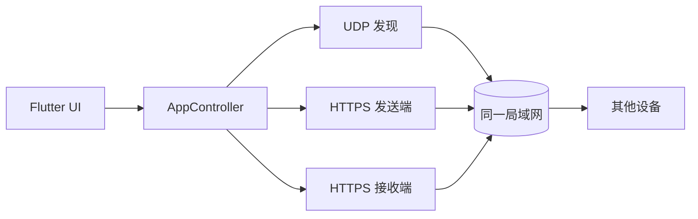

# 邻传 · LANBridge

> 跨平台局域网文件互传。不登录、不上传云端，文件只在设备之间流动。

邻传是一款面向局域网的跨平台文件传输应用。手机、平板和电脑连接同一个 Wi-Fi 或手机热点后，可以自动发现附近设备并直接发送文件或文件夹；传输使用 HTTPS，不依赖账号体系，也不需要经过开发者服务器。

项目使用 Flutter 构建，实现了 LocalSend v2.2 协议的核心传输流程，并针对 Android、Windows 和 HarmonyOS 做了原生适配。

> 当前版本：`0.1.0`。项目仍在快速迭代，接口、文件格式和平台行为可能变化。

## 功能

- **局域网自动发现**：UDP 组播、广播和子网扫描三种方式，兼容普通路由器和手机热点。
- **跨平台互传**：Windows、Android、HarmonyOS 之间发送文件或文件夹。
- **批量传输**：一次选择多个文件，支持整个文件夹。
- **进度与取消**：发送端和接收端都能取消；每个文件使用独立连接，避免单个文件失败影响后续文件。
- **后台传输**：Android 使用前台数据同步服务，HarmonyOS 使用 `dataTransfer` 长时任务；切后台后活动传输继续。
- **桌面拖放**：Windows/Linux 可把文件或文件夹直接拖入窗口发送。
- **安全传输**：HTTPS 加密、证书指纹校验、可选 PIN 保护。
- **本地优先**：无账号、无云端中转、无广告或统计 SDK；设置、证书和传输记录只保存在本机。
- **响应式界面**：同一套 Flutter UI 适配手机、平板和桌面窗口。
- **可选物理主题设备名**：每次启动自动生成随机名称，并避开附近同名设备。
- **LocalSend 兼容**：可与支持 LocalSend v2.2 协议的客户端互通。

## 平台支持

| 平台 | 状态 | 说明 |
| --- | --- | --- |
| Windows 10/11 x64 | 支持 | 只提供免安装压缩包；支持拖放发送 |
| Android | 支持 | 提供 APK；支持前台服务后台传输、通知和存储授权 |
| HarmonyOS | 源码支持 | 有构建入口，尚未发布和充分验证 |
| Linux | 源码支持 | 有桌面构建入口，尚未提供正式发行包 |
| macOS | 源码支持 | 有构建入口，尚未发布和充分验证 |
| iOS | 实验性源码 | 有构建入口；不支持原始套接字后台传输，尚未发布 |
| Web | 不支持 | 依赖 `dart:io` 套接字和本地网络服务 |

HarmonyOS 端文件固定保存在应用沙箱目录，不支持像桌面和 Android 一样选择公共目录。iOS 端需要本地网络权限；由于系统后台限制，切后台后传输可能被取消。

## 获取

GitHub Releases 页面：

- Windows：`邻传-v0.1-windows-portable.zip`（解压后运行 `lanbridge.exe`，不提供 MSIX 或安装器）
- Android：`邻传-v0.1-android.apk`

Windows 首次运行时如果出现防火墙提示，请允许应用在“专用网络”和“公用网络”通信；连接手机热点时通常会被识别为公用网络。否则另一台设备可能无法连接。

## 快速开始

### 环境要求

- Flutter `3.41.x`，Dart `3.11.x`
- Android：Android SDK 36、JDK 17+
- Windows：Visual Studio 2022 或更高版本，安装“使用 C++ 的桌面开发”
- HarmonyOS：DevEco Studio `5.0.5.315+`、HarmonyOS SDK API 26，以及支持 OHOS 的 Flutter 分支
- Linux：GTK 3 开发库、`clang`、`cmake`、`ninja`、`pkg-config`

### 运行

```bash
flutter pub get
flutter devices
flutter run -d windows
```

Android 或 HarmonyOS 设备：

```bash
flutter run -d <device-id>
```

应用启动后会同时启动本机 HTTPS 接收服务和局域网发现。两台设备必须在同一局域网，且防火墙/热点未开启客户端隔离。

## 构建

### Windows

```powershell
flutter build windows --release
New-Item -ItemType Directory -Force dist | Out-Null
Compress-Archive -Path build\windows\x64\runner\Release\* -DestinationPath dist\邻传-v0.1-windows-portable.zip -Force
```

Windows 只发布免安装压缩包，不生成 MSIX、MSI 或独立安装器。压缩包内包含 `lanbridge.exe`，它是程序本体，不是安装器。首次运行如出现防火墙提示，请允许专用和公用网络。

### Android

```bash
flutter build apk --release
```

Android 端需要以下能力：

- `INTERNET` 和网络状态权限
- 前台数据同步服务及通知权限
- Android 公共下载目录写入授权（Android 10+ 会引导到系统设置）

### HarmonyOS

```bash
flutter build hap --release
```

构建前需要：

1. 使用支持 OHOS 的 Flutter SDK，而不是官方标准 Flutter。
2. 在 DevEco Studio 中打开 `ohos/`，配置应用签名和证书。
3. 确认 `ohos/entry/src/main/module.json5` 中的权限和 `dataTransfer` 后台模式。
4. 使用自己的 HarmonyOS 签名证书重新签名，不要提交签名材料。

HarmonyOS 原生能力位于 `ohos/entry/src/main/ets/plugins/LanBridgePlugin.ets`，负责：

- 照片/文件/文件夹选择器
- 选择结果复制到应用缓存
- 应用沙箱路径
- 后台长时任务
- 本地通知
- 打开接收文件夹

### Linux

```bash
flutter build linux --release
```

Linux 构建需要在 Linux 环境中执行；当前仓库没有附带经过验证的 Linux 发行包。

## 工作原理



### 设备发现

- UDP 组播地址：`224.0.0.167`
- 同时发送局域网广播，兼容部分热点不转发组播的情况
- 以 `/24` 子网扫描作为兜底
- 优先使用 Wi-Fi/热点/以太网接口，避开蜂窝接口
- 当前应用在前台时进行发现和扫描；退后台后暂停发现以降低 CPU 占用，活动传输继续

### 传输协议

- LocalSend v2.2 兼容接口：
  - `GET /api/localsend/v2/info`
  - `POST /api/localsend/v2/register`
  - `POST /api/localsend/v2/prepare-upload`
  - `POST /api/localsend/v2/upload`
  - `POST /api/localsend/v2/cancel`
- 每个文件使用独立 HTTPS 连接
- 分块上传，进度 UI 约 200ms 刷新一次
- 支持发送端和接收端取消
- 包含无进度超时、会话清理和临时文件清理

### 安全与隐私

- 文件传输使用 HTTPS/TLS
- 发送端校验接收端证书指纹
- HarmonyOS 对端使用自签名证书时会放行，以兼容 OpenHarmony Flutter 引擎的证书行为
- 可选 PIN 校验，降低误连接风险
- 设备名称、局域网地址、证书指纹和文件信息只用于设备发现、连接和传输
- 不接入开发者云端服务器，不收集账号、通讯录、位置、相机或麦克风信息
- 不集成广告、统计、推送、支付或账号 SDK

> 局域网传输并不等于绝对安全。请只在可信网络中使用，必要时开启 PIN 并核对设备指纹。

## 项目结构

```text
lib/
  core/                 平台判断、主题、工具函数
  data/
    app_controller.dart 应用状态与传输编排
    app_settings_store.dart
    models/             设备、传输、设置模型
    network/            发现、HTTPS 客户端/服务端、协议、证书
  ui/
    shell/              响应式应用外壳
    pages/              附近、发送、传输、设置页面
    sheets/             传输确认与接收弹窗
    widgets/            玻璃表面、设备卡片、进度等组件
ohos/
  entry/                HarmonyOS 应用入口
  entry/src/main/ets/   本地 ArkTS 插件
android/                Android 前台服务与权限
windows/linux/macos/   桌面平台工程
test/                  网络、设置和界面测试
```

## 测试

```bash
flutter analyze
flutter test
```

目前测试覆盖：

- HTTPS LocalSend 核心传输与证书指纹校验
- 大文件传输不中断
- 多文件独立连接
- 取消广播与远端取消
- 路径穿越防护
- 设置持久化
- 设备名自动生成与唯一性
- 桌面和移动端基础界面

## 已知限制

- 只能在同一局域网内使用，不提供互联网中继。
- 手机热点的 AP 隔离、路由器客户端隔离或系统防火墙可能阻止发现；可关闭隔离，或在应用内手动输入 IP。
- 应用退到后台后会暂停自动发现以控制 CPU，前台恢复后重新开始广播。
- HarmonyOS 文件保存在应用沙箱，不支持公共目录。
- iOS 不支持原始套接字后台传输。
- Web 平台不支持本地网络服务。
- Linux、HarmonyOS、macOS 和 iOS 尚未提供正式发行包。

## 常见问题

**找不到设备怎么办？**

确认两台设备在同一网段；允许 Windows 防火墙在专用和公用网络通信；关闭手机热点的 AP 隔离；也可以使用手动连接，输入对方的局域网 IP 和端口。

**为什么切到后台后搜索不到我？**

为了降低后台 CPU 占用，应用退到后台后会暂停发现广播。正在进行的传输不受影响，回到前台后会恢复。

**为什么 HarmonyOS 只能保存到应用沙箱？**

当前 HarmonyOS 文件访问使用系统 Picker 和应用沙箱路径，公共目录写入没有作为默认能力开放。

**这个项目与 LocalSend 是什么关系？**

本项目实现了 LocalSend v2.2 协议兼容，但不是 LocalSend 官方项目，也不代表 LocalSend 团队。

## 贡献

欢迎提交 Issue 和 Pull Request：

1. 先搜索已有 Issue，避免重复。
2. 报告问题时附上平台、系统版本、应用版本、复现步骤和必要日志；不要上传包含文件内容或敏感路径的完整日志。
3. 提交代码前运行 `flutter analyze` 和 `flutter test`。
4. 修改传输协议相关代码时，请保持 LocalSend v2.2 兼容性，并补充测试。
5. 不要提交签名证书、私钥、`dist/`、构建产物或本地 SDK 路径。

## 致谢

- [Flutter](https://flutter.dev/) 和 OpenHarmony Flutter 分支；
- [LocalSend](https://localsend.org/) 的开放协议设计；
- `file_picker`、`path_provider`、`desktop_drop` 等开源依赖。

## License

本项目使用 [Apache License 2.0](LICENSE) 开源。

Copyright 2026 纷染雪落。

第三方组件和 LocalSend 协议来源见 [THIRD_PARTY_NOTICES.md](THIRD_PARTY_NOTICES.md)，项目归属声明见 [NOTICE](NOTICE)。
